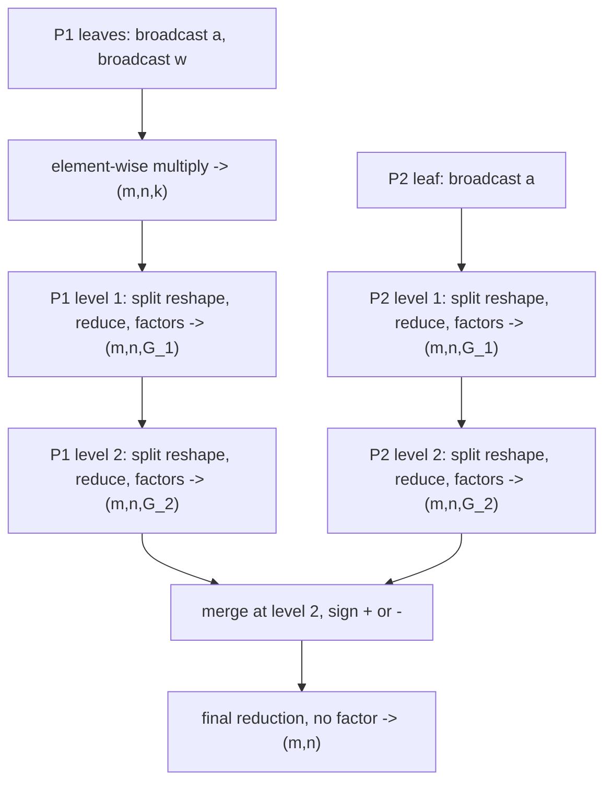

# QGEMM Canonical Form

Purpose: define the tensor-level writing convention for expressing QGEMM in Triton so that later compiler work can recognize its hierarchical scaling structure and recover each operand's real memory layout.

Audience: users writing QGEMM kernels and compiler developers implementing recognition, pass organization, and loop scheduling and data layout work.

Authoritative source: `reports/开题报告.md`, sections 4.1.1, 4.1.2, and 4.1.3, in research content 1, 「CPU 上跨平台性能可移植的 QGEMM 编程系统设计」. The proposal takes precedence over steering documents when they disagree.

Reading conventions:

- Dimensions are compile-time constants unless stated otherwise.
- Numbered steps refer to the sequence in section 2.
- Future compiler obligations do not describe an implemented pass.

## 1. Notation

| Symbol | Meaning |
|--------|---------|
| `M`, `N`, `K` | Logical operator size: activation `(M, K)` and weight `(N, K)` produce `(M, N)`; `K` is the reduction dimension |
| `T` | Number of programs, with `N % T == 0` |
| `m`, `n`, `k` | Per-program logical extents: `m = M`, `n = N // T`, `k = K` |
| `p` | A path of the reduction DAG, running from its leaves to a merge point or to the final reduction |
| `L^p` | Number of levels on the divisibility chain of path `p`, `L^p >= 1`; the superscript is dropped, leaving `L`, `QK_j`, `r_j`, `G_j`, wherever only one path is under discussion |
| `QK_j^p` | Quantization block size of level `j` on path `p`, with `QK_0^p = 1` |
| `r_j^p` | `QK_j^p / QK_{j-1}^p`; therefore `r_1^p = QK_1^p` |
| `G_j^p` | `K / QK_j^p`, the reduction length left after level `j` of path `p`; `G_0^p = K` |
| `C(v)` | Cumulative quantization block size at position `v`: the element count already reduced there, equal to the product of the split ratios of the levels of that path before `v` |
| `j_merge`, `sign` | The level at which two paths merge, and the sign, `+` or `-`, written there |

## 2. Compute Sequence

The canonical form is a property of the whole reduction DAG leading from the input components to the output `(m, n)`. Every path of that DAG has the same shape:

1. Every leaf operand is broadcast to `(m, n, k)`.
2. Two broadcast leaves are multiplied element-wise, producing `(m, n, k)`. A degenerate path has a single leaf and no element-wise multiply, so this step is absent there.
3. For each level `j = 1, ..., L^p` of the path's divisibility chain, in ascending block-size order: (a) a split-direction `tl.reshape` splits the current reduction dimension as `(G_j^p, r_j^p)`, with `r_j^p` innermost; (b) that innermost dimension is reduced; (c) the level's factors are applied.
4. Paths may merge, each merge joining two operands at any level through one addition or subtraction.
5. The whole DAG ends in one reduction that carries no factor and produces `(m, n)`.



The one legality condition on a merge is that both operands carry the same cumulative quantization block size `C` there, equivalently the same current shape. Neither the level index nor the inner split structure of the two paths has to agree. A path whose factors exist only at the outer level may skip the inner split and reduce 256 elements in one step: its level index is 1 where the main path's is 2, and the merge stays legal, because both operands have reduced 256 elements. Deciding by equal level indices, or by walking the two chains and demanding the two paths agree on every level's block size, rejects that writing wrongly.

| Path-internal step | Operation | Shapes | Stage |
|--------------------|-----------|--------|-------|
| leaf | weight decompression, or a plain load on a side already stored as the integer value | stored components -> `a: (m, k)` or `w: (n, k)` | data preparation |
| broadcast | `tl.expand_dims`, `tl.broadcast_to` | `(m, k)` or `(n, k)` -> `(m, n, k)` | matrix multiplication |
| element-wise multiply | product casts and multiply of the two broadcast leaves | two `(m, n, k)` -> `(m, n, k)` | matrix multiplication |
| level `j` split and reduce | split-direction `tl.reshape`, then reduce the innermost dimension | `(m, n, G_{j-1}) -> (m, n, G_j, r_j) -> (m, n, G_j)` | matrix multiplication |
| level `j` split and reduce, degenerate path | the block sum of a zero-point branch, which is level 1 of that path | `(m, n, k) -> (m, n, G_j, r_j) -> (m, n, G_j)` | matrix multiplication |
| level `j` factors | apply this level's factors to this level's reduction result | `(m, n, G_j) -> (m, n, G_j)` | scaling |
| merge | one addition or subtraction of two paths with equal `C` | two `(m, n, G_j) -> (m, n, G_j)` | scaling |
| final reduction | outermost plain reduction, carrying no factor | `(m, n, G_L) -> (m, n)` | scaling |

### Single-path instance

A format whose DAG is a single path with no merge point instantiates the above as the following numbered sequence. The `# step` comments of the verification kernel in section 10 and the `// step` annotations of the measured IR in section 12 are the step numbers of this single-path instance, corresponding one-to-one to the path-internal steps above.

1. The data preparation stage decompresses the stored weight into the integer operand `w: (n, k)`; the activation enters as the integer operand `a: (m, k)`.
2. The matrix multiplication stage inserts the missing parallel dimension with `tl.expand_dims` and broadcasts both operands to `(m, n, k)` with `tl.broadcast_to`, as written out in section 10.
3. After conversion to the product type, the two three-dimensional operands are multiplied element-wise, producing `(m, n, k)`.
4. For each level `j = 1, ..., L` in ascending block-size order: (a) split the current reduction dimension as `(G_j, r_j)` with `r_j` innermost; (b) reduce that innermost dimension; (c) apply the level's factors to the reduction result.
5. Reduce the remaining dimension `G_L` without a factor, producing `(m, n)`.

For `L = 1` the levels expand as `(m,n,K) -> (m,n,K/QK_1,QK_1) -> (m,n,K/QK_1) -> (m,n,K/QK_1) -> (m,n)`.

For `L = 2` with `K = 512`, `QK_1 = 32`, `QK_2 = 256`, hence `G_1 = 16`, `G_2 = 2`, `r_2 = 8`: `(m,n,512) -> (m,n,16,32) -> (m,n,16) -> (m,n,16) -> (m,n,2,8) -> (m,n,2) -> (m,n,2) -> (m,n)`.

No path contains `tl.dot`. A writing that splits the quantization-block dimensions before broadcasting and directly broadcasts four- or five-dimensional tensors, as existing kernels under `benchmark/kernels/` do, is not the canonical form.

## 3. Divisibility Chain

The chain is per path. Path `p` reads its own chain from its own split reshapes: if their innermost extents, written from inner to outer, are `r_1^p, ..., r_{L^p}^p`, then

```
QK_j^p = r_1^p * ... * r_j^p
```

Chain order is therefore the order in which that path's split reshapes are written from the innermost quantization level outward, block sizes strictly increase along the chain, and each block size is an integer multiple of the previous one. `K` is an integer multiple of `QK_{L^p}^p`, and consequently of every level of that path.

Within one path the levels collect the quantization levels of both its leaves: equal block sizes on the two sides become one level, unequal sizes stay separate levels. A factor may exist on only one side at a level; the other side then contributes the constant factor 1, leaving that level's shape unchanged.

Two paths of the same DAG need not agree. Their numbers of levels may differ, and their level `j` may carry different block sizes. Nothing ties two chains together except a merge point, where the two operands must have the same cumulative quantization block size `C`, equivalently the same current shape; merging two intermediate results with unequal `C` is not the canonical form. That single condition is the reduction-DAG form of forbidding a factor to move across levels: a factor belongs to the level whose reduction produced the value it multiplies, and joining values that have reduced different element counts would be the only way to slide it elsewhere.

For Q4_K x Q8_K the DAG has two paths, each with the chain `{32, 256}`:

| Level | Path | Block size and ratio | Factor sources | Reduction dimension |
|-------|------|----------------------|----------------|---------------------|
| 1 | main | `QK_1 = r_1 = 32` | weight `sc`; activation factor is 1 | `K -> K/32` |
| 1 | zero point | `QK_1 = r_1 = 32` | weight `m`; activation factor is 1 | `K -> K/32` |
| 2 | main | `QK_2 = 256`, `r_2 = 8` | weight `d`; activation `a_d` | `K/32 -> K/256` |
| 2 | zero point | `QK_2 = 256`, `r_2 = 8` | weight `dmin`; activation `a_d` | `K/32 -> K/256` |

The two paths merge after level 2, where both carry `C = 256`, with the sign the user wrote there, a minus for Q4_K.

## 4. Factor Invariance and Branch Linearity

Factor invariance is the one load-bearing condition of the canonical form: a factor does not vary along the dimension reduced at its level. Its algebraic basis is `sum_r (s * x_r) = s * sum_r x_r`, which holds exactly when `s` does not vary with `r`, and it is readable straight off Linalg: the factor operand's indexing map over that level's iteration domain does not contain the reduced dimension.

Applying a factor before the reduction and applying it afterwards are therefore two writings of one thing, and recognition accepts both. A factor tensor whose rank equals that of the level's reduction result `(m, n, G_j)` is the post-reduction special case: the reduced dimension is not in the iteration domain at all, so invariance holds automatically. A factor applied before the reduction is equally invariant as long as its map omits that dimension. A factor absent from one side is the constant 1.

Two factors at one level, one per side, may be multiplied together and applied once, or applied in sequence; invariance plus commutativity of multiplication makes the two forms equivalent. The choice is the user's because multiplication order affects floating-point precision, and compiler transformations preserve the order written:

```python
level = red.to(tl.float32) * (a_d.to(tl.float32) * w_d.to(tl.float32))   # factors first
level = red.to(tl.float32) * a_d.to(tl.float32) * w_d.to(tl.float32)     # or in sequence
```

Branch linearity makes a zero point an ordinary path rather than a special case. Its leaf is a single broadcast operand, readable as a degenerate element-wise multiply against the constant 1; its per-level factors are that format's zero-point factors, `m` at level 1 and `dmin` at level 2 for Q4_K; and it joins the main path at one level through a subtraction. The sign is the one the user wrote, and recognition records only whether a merge point adds or subtracts. A zero point on each of the two operands is then expressible directly: `(a_q - a_z)(w_q - w_z)` expands into four paths merged with `+` and `-`, each path satisfying the invariant of section 2 on its own.

## 5. Cast Positions

The following positions are writing-style recommendations that make type boundaries visible:

| Type role | Suggested position |
|-----------|--------------------|
| product type | convert both three-dimensional operands immediately before the element-wise multiply |
| accumulation type | convert the summand consumed by each level's block reduction |
| scaled type | convert each reduction result immediately before that level's factors are applied |

The user chooses each concrete type freely from Triton's scalar types. Each level of each path may choose its accumulation and scaled types independently.

An identity conversion may be omitted. The outermost reduction uses the element type produced by the last scaling level unless the user explicitly converts for output storage.

These positions do not impose bit-width relationships or require a floating-point scaled type. Avoiding overflow and choosing adequate precision remain the user's responsibility.

## 6. Decompression Region

The decompression region is the computation that turns stored components into the integer values entering the matrix multiplication. Its boundary is found by walking upstream from that integer operand to the loads of kernel pointer arguments. A region may contain element-wise arithmetic, bit manipulation, table lookup, and static dimension transformations, but it contains no reduction and no reduction iterator. A side already stored as the integer value used by step 2 has a degenerate region consisting only of its load and any required conversion.

The four reference formats establish the following writing checklist:

| Format or component | Operations actually used | Required result |
|---------------------|--------------------------|-----------------|
| Q8_0 integer values | `tl.make_block_ptr`, `tl.load`, optional type conversion | direct `(m, k)` or `(n, k)` integer operand |
| Q4_0 weight values | static `tl.reshape`, bitwise `&` and `>>`, integer conversion and subtraction of 8, order-preserving `tl.join`, `tl.trans`, and a final `tl.reshape` | `(n, k)` values in the GGML within-block order |
| Q4_K weight values | static shape view, nibble masks and shifts, order-preserving `tl.join`, `tl.trans`, and `tl.reshape` | `(n, k)` values whose two nibbles use their proper adjacent sub-blocks |
| Q4_K factors | three fixed-offset `tl.make_block_ptr` loads, masks, shifts, integer bitwise operations, `tl.join`, `tl.trans`, and `tl.reshape` | `sc` and `m` with shape `(n, G_1)` |
| iq2_xxs weight values | static `tl.reshape`, `tl.trans`, `tl.split`, bit-field shifts and masks, pointer-tensor `tl.load` for the grid and sign table, `tl.where`, and static shape transformations | signed `(n, k)` codebook-decoded values |
| iq2_xxs factors | extraction of the high four bits of `aux32[1]`, broadcast of `d`, and `f32` multiply/add by the constants in `d * (0.5 + s) * 0.25` | level-1 factor with shape `(n, G_1)` |

These operations are subject to six writing constraints. First, every shape transformation in a format decoder uses compile-time extents; a factor or value decoder may expose the physical format dimensions, but it must return the logical shape required by the next canonical step. Second, the physical pairing semantics are explicit: Q4_0 keeps both nibbles in one 32-value block, while Q4_K assigns them to adjacent 32-value sub-blocks. Third, the IQ2 codebook and sign accesses use pointer-tensor `tl.load`; `tl.gather` is not part of this writing convention. Fourth, lookup-index arithmetic remains in the region, and the fixed tables are additional read-only inputs rather than separate quantized components. Fifth, no region contains `tl.sum`, a reduction, or an operation whose reduction dimension crosses the region boundary. Sixth, a factor-side result has no `r_j` dimension: it is indexed by the remaining `(m, n, G_j)` coordinates and is therefore invariant along the dimension reduced at level `j`.

Triton represents a quantized tensor as planar components. Q4_K therefore has separate `q`, `d`, `dmin`, and packed `scales` inputs, whereas iq2_xxs has exactly two weight components, `d` and `qs`; its codebook, sign table, and mask table are fixed format tables, not independent weight components. The index computation that reaches a table lookup remains part of the path from `qs` to the decoded value. Factor-side decoding follows the same boundary rule as weight decoding: walk upstream from the factor operand to its pointer loads. Q4_K unpacks the packed 6-bit factors, and iq2_xxs derives its sub-block factor from the scale code in `qs`. Neither operation contains a reduction, so factor invariance depends on the resulting shape and indexing map, not on the length of the decoding chain.

## 7. Layout Expression Chains

Each input component that reaches the computation without decoding — the activation quantized values, and a factor that is loaded rather than derived — expresses its real memory layout with the chain `multidimensional tl.make_block_ptr + tl.load -> a sequence of tl.trans and tl.reshape steps -> the logical shape`. The sequence may have any finite length, and there are only two conditions on it: every step's arguments are compile-time constants, and the whole sequence composes into one static permutation followed by one fold, from which the physical dimension order, each dimension's length, and each dimension's stride are still recoverable. Neither transformation is restricted to a single occurrence. A physical layout whose logical dimension order appears only once two of the loaded dimensions have been split apart is written `reshape -> trans -> reshape`: the first reshape exposes the split, the permutation puts the pieces in logical order, and the second reshape folds them back. Limiting each transformation to one occurrence would reject that writing for no reason. A component that has to be decoded is governed by section 6 instead, which constrains the shape its decoding produces rather than the way its stored form is loaded.

`tl.make_block_ptr` declares the real physical dimension order through `shape`, the element stride of each dimension through `strides`, and row-major traversal through descending `order = (rank-1, ..., 0)`. These values, the permutation, and the reshape targets are statically evaluable from literals and `tl.constexpr` values. `tl.trans` maps physical dimension order to logical dimension order, and `tl.reshape` then folds adjacent dimensions to that component's own logical shape: `(m, k)` or `(n, k)` for quantized values that need no decoding, and `(m, G_j)` on the activation side or `(n, G_j)` on the weight side, with `G_j = K / QK_j`, for a level `j` factor that is loaded rather than derived. A zero-point component has the same shape as its level's scale factor component and runs the same chain. Identity permutation or fold steps may be omitted.

For a weight stored physically as `(k/QK, QK, n)` but used logically as `(n, k)`:

```python
w_block = tl.make_block_ptr(base=w_ptr, shape=(K // QK, QK, N), strides=(QK * N, N, 1),
                            offsets=(0, 0, n_start), block_shape=(K // QK, QK, n_per_pid),
                            order=(2, 1, 0))
w = tl.load(w_block)                 # (K/QK, QK, n)
w = tl.trans(w, 2, 0, 1)             # (n, K/QK, QK)
w = tl.reshape(w, (n_per_pid, K))     # (n, k)
```

| Recovered fact | Static source | Value |
|----------------|---------------|-------|
| physical order and lengths | `shape` | `(kb, qk, n)`, `(K/QK, QK, N)` |
| physical strides | `strides` | `(QK*N, N, 1)` |
| row-major traversal | `order` | physical dimensions `2, 1, 0` from fastest to slowest |
| logical `n` | permutation entry 0 | physical dimension 2, stride 1 |
| logical `k` | permutation entries 1 and 2 plus reshape | physical dimensions 0 and 1 folded to `K` |

The output uses the mirror chain `tl.reshape(physical shape) -> tl.trans(logical-to-physical permutation) -> multidimensional tl.make_block_ptr + tl.store`: the reshape splits logical dimensions into physical dimensions, and the permutation puts them in physical order before one store. When the real layout already matches logical `(m, n)`, both transformations are identities and may be omitted:

```python
c_block = tl.make_block_ptr(base=c_ptr, shape=(M, N), strides=(N, 1),
                            offsets=(0, n_start), block_shape=(M, n_per_pid), order=(1, 0))
tl.store(c_block, c)
```

This output convention gives WP B5 the information needed to combine result write-back with the user's output layout adaptation.

## 8. Thread-Level Partition

The partition described here is the reference writing used by the verified example of section 10, not a condition of the canonical form: a one-dimensional grid of `T` programs in which program `pid = tl.program_id(0)` computes the non-overlapping N-direction slice `[n_start, n_start + n_per_pid)` of output `(M, N)`, takes M and K at full extent, and contains no user loop and no user-written register-level tiling.

```python
pid = tl.program_id(0)
n_per_pid: tl.constexpr = N // T
n_start = pid * n_per_pid

tl.device_assert(tl.num_programs(0) == T, "grid.x must equal T")
tl.device_assert(tl.num_programs(1) == 1, "grid.y must be 1")
tl.device_assert(tl.num_programs(2) == 1, "grid.z must be 1")
tl.device_assert(tl.num_programs(0) * n_per_pid == N, "N must be divisible by T")
```

Weight and output block pointers use `n_start` and `n_per_pid` along N. Activation, weight, and component accesses express M and K at full extent, with no M- or K-direction program slice.

Recognition is not conditioned on this partition. The invariant of section 2 holds of the reduction DAG inside a single program, and the partition only decides which `(m, n, k)` slice a program receives; enumerating the paths upstream from the final reduction reads the already-sliced shapes. No legality condition of sections 2, 3 and 4 mentions the grid, the sliced dimension, or the number of programs. A two-dimensional grid, a partition along M, and other partitions are therefore accepted writings, untested rather than non-conforming; section 13 records them as such.

Absence of a user loop and of user-written register-level tiling is likewise part of the reference writing. One program's N slice is the outermost unit for further compiler tiling; its width does not constrain the innermost tile size. Those decisions belong to Phase B and Phase C. The three-dimensional product of step 3 is a logical tensor, whose physical working-set size Phase B controls through tiling.

## 9. Numeric Contract

| Transformation | Verdict | Boundary |
|----------------|---------|----------|
| reassociate additions within one reduction dimension | allowed | reassociation does not cross a level's factor application |
| tile parallel or reduction dimensions | allowed | each K tile boundary is an integer multiple of the quantization block size of every level of every path |
| join two intermediate results | allowed at a merge point | both operands carry the same cumulative quantization block size `C` there, equivalently the same current shape; equal level indices and equal inner split structure are not required |
| change a product, accumulation, or scaled bit width | forbidden | compiler transformations preserve the user-selected types |

Equal `C` at every merge point is what holds each factor at its own level: a factor stays with the reduction result it multiplies, and joining values that have reduced different element counts would be the only way to slide it elsewhere. The sign of each merge point and the level it sits at are the user's decisions, and compiler transformations preserve both, as they preserve the multiplication order of the factors at one level.

Allowed transformations may reorder floating-point additions, so correctness tests compare floating-point results with `atol` and `rtol` rather than requiring bit equality. When both product and accumulation types are integer types, the corresponding integer reduction results are compared bit-exactly.

## 10. Verified Example: Q8_0 × Q8_0

Q8_0 stores 32 signed 8-bit values and one `float16` scale per block. Both operands use Q8_0, so the merged divisibility chain has one level with factors on both sides. The module-level constants used below are `QK8_0 = 32` and `TL_QK8_0 = tl.constexpr(QK8_0)`.

```text
components: `a_q: int8 (m,k)`, `a_d: float16 (m,G_1)`, `w_q: int8 (n,k)`, `w_d: float16 (n,G_1)`
chain: `{32: both}`, with `L = 1`, `QK_1 = r_1 = 32`, and `G_1 = K / 32`
factors: level 1 uses activation `a_d` and weight `w_d`
region: each side is a degenerate decompression region from its quantized-value load to the integer operand entering step 2
```

The `# step` comments and adjacent shape comments are the step-by-step shape ledger; their numbers are those of the single-path instance of section 2, one per path-internal step there, because this format's DAG is a single path with no merge point. The grid is the reference partition of section 8, and the layout expression chains of section 7 are identities here because physical order equals logical order, so `tl.trans` and the layout `tl.reshape` are omitted. The body below is reproduced from `benchmark/kernels/q80_q80_strict.py`, with the block-pointer argument lists re-wrapped onto fewer lines and the step comments condensed, and nothing else changed.

```python
@triton.jit
def q80_q80_strict(
    a_q_ptr,    # int8    (M, K)
    a_d_ptr,    # float16 (M, K // QK)
    w_q_ptr,    # int8    (N, K)
    w_d_ptr,    # float16 (N, K // QK)
    c_ptr,      # float32 (M, N)
    M: tl.constexpr,
    N: tl.constexpr,
    K: tl.constexpr,
    T: tl.constexpr,
):
    QK: tl.constexpr = TL_QK8_0
    KB: tl.constexpr = K // QK  # G_1, the reduction length left after level 1

    pid = tl.program_id(0)
    n_per_pid: tl.constexpr = N // T
    n_start = pid * n_per_pid

    tl.device_assert(tl.num_programs(0) == T, "grid.x must equal T")
    tl.device_assert(tl.num_programs(1) == 1, "grid.y must be 1")
    tl.device_assert(tl.num_programs(2) == 1, "grid.z must be 1")
    tl.device_assert(tl.num_programs(0) * n_per_pid == N, "N must be divisible by T")

    a_q_block_ptr = tl.make_block_ptr(base=a_q_ptr, shape=(M, K), strides=(K, 1),
                                      offsets=(0, 0), block_shape=(M, K), order=(1, 0))
    a_d_block_ptr = tl.make_block_ptr(base=a_d_ptr, shape=(M, KB), strides=(KB, 1),
                                      offsets=(0, 0), block_shape=(M, KB), order=(1, 0))
    w_q_block_ptr = tl.make_block_ptr(base=w_q_ptr, shape=(N, K), strides=(K, 1),
                                      offsets=(n_start, 0), block_shape=(n_per_pid, K), order=(1, 0))
    w_d_block_ptr = tl.make_block_ptr(base=w_d_ptr, shape=(N, KB), strides=(KB, 1),
                                      offsets=(n_start, 0), block_shape=(n_per_pid, KB), order=(1, 0))
    c_block_ptr = tl.make_block_ptr(base=c_ptr, shape=(M, N), strides=(N, 1),
                                    offsets=(0, n_start), block_shape=(M, n_per_pid), order=(1, 0))

    # step 1 (data preparation): decompression region degenerates to a load, because Q8_0 values need no decoding
    a_q = tl.load(a_q_block_ptr)                            # (M, K)          int8
    w_q = tl.load(w_q_block_ptr)                            # (n_per_pid, K)  int8

    # step 2 (matrix multiplication): expand_dims + broadcast_to to 3-D; step 3: cast to the product type, multiply
    a_q3 = tl.expand_dims(a_q, axis=1)                      # (M, 1, K)
    a_q3 = tl.broadcast_to(a_q3, (M, n_per_pid, K))         # (M, n_per_pid, K)
    w_q3 = tl.expand_dims(w_q, axis=0)                      # (1, n_per_pid, K)
    w_q3 = tl.broadcast_to(w_q3, (M, n_per_pid, K))         # (M, n_per_pid, K)
    prod = a_q3.to(tl.int16) * w_q3.to(tl.int16)            # (M, n_per_pid, K) int16

    # step 4.1.a (matrix multiplication): split-direction reshape; step 4.1.b: reduce the block dim in int32
    prod4 = tl.reshape(prod, (M, n_per_pid, KB, QK))        # (M, n_per_pid, KB, 32)
    blk = tl.sum(prod4.to(tl.int32), axis=3)                # (M, n_per_pid, KB) int32

    # step 4.1.c (scaling): apply the level-1 factors, variant 1 (both sides multiplied together first, then applied once)
    a_d = tl.load(a_d_block_ptr)                            # (M, KB)
    a_d3 = tl.expand_dims(a_d, axis=1)                      # (M, 1, KB)
    a_d3 = tl.broadcast_to(a_d3, (M, n_per_pid, KB))        # (M, n_per_pid, KB)
    w_d = tl.load(w_d_block_ptr)                            # (n_per_pid, KB)
    w_d3 = tl.expand_dims(w_d, axis=0)                      # (1, n_per_pid, KB)
    w_d3 = tl.broadcast_to(w_d3, (M, n_per_pid, KB))        # (M, n_per_pid, KB)

    d = a_d3.to(tl.float32) * w_d3.to(tl.float32)           # (M, n_per_pid, KB) f32
    lvl1 = blk.to(tl.float32) * d                           # (M, n_per_pid, KB) f32

    # step 5 (scaling): outermost plain reduction, no scale factor
    c = tl.sum(lvl1, axis=2)                                # (M, n_per_pid) float32

    tl.store(c_block_ptr, c)
```

## 11. Per-Format Difference Notes

The four rows below are the reference formats actually compiled, numerically checked, and captured in section 12. Each row instantiates the invariant of section 2; the notes list only what differs from the verified Q8_0 × Q8_0 example of section 10.

| Format | Paths and leaves | Levels: block size, factors, side | Merge |
|--------|------------------|-----------------------------------|-------|
| Q8_0 × Q8_0 | one path; leaves `a_q`, `w_q` | `L = 1`, `QK_1 = 32`; activation `a_d` and weight `w_d` | none |
| Q4_0 × Q8_0 | one path; leaves `a_q`, decoded `w_q` | `L = 1`, `QK_1 = 32`; activation `a_d` and weight `w_d` | none |
| Q4_K × Q8_K | two paths; main leaves `a_q`, `w_q`; zero-point path leaf `a_q` | `{32, 256}`; level 1 weight `sc` on the main path and `m` on the zero-point path; level 2 weight `d` with activation `a_d` on the main path and `dmin` with activation `a_d` on the zero-point path | level 2, minus |
| iq2_xxs × Q8_K | one path; leaves `a_q`, codebook-decoded `w_q`; IQ2 weight components are only `d` and `qs` | `{32, 256}`; level 1 weight factor decoded from `d` and the `s` field in `qs`; level 2 activation factor `a_d` | none |

**Q4_0 × Q8_0**

- Components: activation `a_q: int8 (m,k)` and `a_d: float16 (m,G_1)`; weight `w_q: uint8 (n,k/2)` and `w_d: float16 (n,G_1)`.
- The packed weight bytes are viewed as `(G_1, QK_1/2)`. For byte `(g, j)`, the low nibble is logical `k = g * QK_1 + j`, and the high nibble is logical `k = g * QK_1 + QK_1/2 + j`. Both nibbles belong to quantization block `g` and share its one weight scale. The reference kernel makes this pairing explicit with an order-preserving join, a transpose, and a fold; it does not split the whole K dimension into two halves.
- The decoder masks and shifts each nibble, subtracts the static offset 8, and returns `w_q: int8 (n,k)`. The measured IR contains the four-dimensional intermediate, the transpose, and the collapse before the value enters the three-dimensional product.

**Q4_K × Q8_K**

- Components: activation `a_q: int8 (m,k)`, `a_d: float32 (m,G_2)`; weight `w_q: uint8 (n,k/2)`, `d`, `dmin`, and the packed 12-byte-per-super-block `scales` component.
- The scale decoder follows `get_scale_min_k4`: for `j < 4`, `sc[j] = scales[j] & 63` and `m[j] = scales[j + 4] & 63`; for `j >= 4`, `sc[j] = (scales[j + 4] & 0xF) | ((scales[j - 4] >> 6) << 4)` and `m[j] = (scales[j + 4] >> 4) | ((scales[j] >> 6) << 4)`. The three four-byte fixed-offset loads and their bit operations produce both `(n,G_1)` level-1 factor tensors without a reduction.
- The packed values use a different pairing from Q4_0. A group of 32 bytes covers 64 values: byte `(group,l)` contributes logical `group * 64 + l` from its low nibble in sub-block `group * 2`, and logical `group * 64 + 32 + l` from its high nibble in sub-block `group * 2 + 1`. The two nibbles therefore use different level-1 factors. The decoder's order-preserving join, transpose, and fold preserve this pairing.
- The numerically correct merge is `main * (d * a_d) - zero * (dmin * a_d)`, with each path applying its own level-2 factors before the subtraction. The structurally accepted level-1 merge `(red1 * sc - bs1 * m) * (d * a_d)` is numerically correct only when `d == dmin`; the negative check in the reference script uses `d != dmin` and confirms that it deviates from the GGML result beyond the floating-point comparison tolerance.

**iq2_xxs × Q8_K**

- The IQ2 weight has exactly two stored components: `d` and `qs`. There are no independent `w_idx`, `w_sign`, or `w_sc` tensors. For each 32-value sub-block, `qs` supplies two little-endian uint32 words: `aux32[0]` contains four 8-bit codebook indices, while `aux32[1]` contains four 7-bit sign indices and its high four bits contain the sub-block scale code `s`. Thus the codebook index, sign index, and scale code are all extracted from `qs`, and the scale code shares the uint32 with the sign indices.
- The codebook is represented in the kernel as `uint8[256, 8]`, the byte view of GGML's `uint64[256]` `iq2xxs_grid`. The sign table is `uint8[128]` (`ksigns_iq2xs`), and `kmask_iq2xs` is `uint8[8]` with values `1, 2, 4, ..., 128`. The two decoded table paths are pointer-tensor `tl.load` operations; the captured IR contains two `linalg.index` and two `tensor.extract` operations and no explicit loop.
- The level-1 factor is the factor-side decoding `d * (0.5 + s) * 0.25`, with shape `(n,G_1)`. The level-2 factor is the Q8_K activation `a_d`, and the chain is `{32,256}`. The captured IR has the integer level-1 reduction over `32`, the floating-point level-2 reduction over `8`, and the final reduction over `G_2`.

## 12. Measured Linalg Appendix

The operation groups below come from one real compilation of the verification kernel `benchmark/kernels/q80_q80_strict.py`, whose DAG is a single path with a single-level divisibility chain, so the `// step` annotations carry the step numbers of the single-path instance of section 2 and step 4.j instantiates as step 4.1. That instance has no merge point, so no addition or subtraction `linalg.generic` appears below; every other operation shape of the invariant does. Nothing in this appendix is hand-written or inferred, which makes it the baseline fact about the Linalg shape of each step of that instance.

```sh
source env.sh
rm -rf "$TRITON_CACHE_DIR"/*
rm -rf .triton/dump/shared
python benchmark/kernels/q80_q80_strict.py
ls .triton/dump/shared/
```

The compilation stage is `ttsharedir`, which runs `triton-shared-opt --triton-to-linalg-experimental` on the TTIR of the preceding stage; its output lands under `$TRITON_SHARED_DUMP_PATH`, by default `.triton/dump/shared`, as the file `ttshared.mlir`. The cache clear is not optional: a kernel already present in `$TRITON_CACHE_DIR` is served from the cache, so no stage runs and no dump appears. The dump holds the last specialization of the run, `M = 192`, `N = 128`, `K = 512`, `T = 4`, hence `n_per_pid = 32` and `G_1 = 16`. Read the shapes against those values: `192x32x512` is `(m, n, k)`, `192x32x16x32` is `(m, n, G_1, QK_1)`, `192x32x16` is `(m, n, G_1)`, and `192x32` is `(m, n)`. Every line below other than the `// step` annotations and the `// ... elided ...` markers is verbatim from that file; each marker stands for a removed region body. Step 1 has no group of its own here: with Q8_0 the region degenerates to a load, and the block pointer plus load lower into `memref.reinterpret_cast`, `memref.copy` and `bufferization.to_tensor` that carry no arithmetic.

```mlir
// step 2 — broadcast of the activation to (m, n, k); #map1 reads (d0, 0, d2), broadcastDims = 1
    %8 = linalg.generic {indexing_maps = [#map1, #map], iterator_types = ["parallel", "parallel", "parallel"]} ins(%6 : tensor<192x1x512xi16>) outs(%7 : tensor<192x32x512xi16>) attrs =  {broadcastDims = array<i64: 1>} {
// ... elided ...
// step 2 — broadcast of the weight to (m, n, k); #map2 reads (0, d1, d2), broadcastDims = 0
    %11 = linalg.generic {indexing_maps = [#map2, #map], iterator_types = ["parallel", "parallel", "parallel"]} ins(%10 : tensor<1x32x512xi16>) outs(%7 : tensor<192x32x512xi16>) attrs =  {broadcastDims = array<i64: 0>} {
// ... elided ...
// step 3 — three-dimensional element-wise multiply in the product type i16
    %12 = linalg.generic {indexing_maps = [#map, #map, #map], iterator_types = ["parallel", "parallel", "parallel"]} ins(%8, %11 : tensor<192x32x512xi16>, tensor<192x32x512xi16>) outs(%8 : tensor<192x32x512xi16>) {
// ... elided ...
// step 4.1.a — split-direction reshape (m, n, k) -> (m, n, G_1, QK_1)
    %expanded_3 = tensor.expand_shape %12 [[0], [1], [2, 3]] output_shape [192, 32, 16, 32] : tensor<192x32x512xi16> into tensor<192x32x16x32xi16> loc(#loc40)
// step 4.1.b — reduction along the innermost quantization block dimension, dimensions = [3]
    %reduced = linalg.reduce ins(%14 : tensor<192x32x16x32xi32>) outs(%16 : tensor<192x32x16xi32>) dimensions = [3] 
// ... elided ...
// step 4.1.c — the two sides' level-1 scale factors multiplied together
    %27 = linalg.generic {indexing_maps = [#map, #map, #map], iterator_types = ["parallel", "parallel", "parallel"]} ins(%23, %26 : tensor<192x32x16xf32>, tensor<192x32x16xf32>) outs(%23 : tensor<192x32x16xf32>) {
// ... elided ...
// step 4.1.c — the combined factor applied to the level-1 reduction result
    %29 = linalg.generic {indexing_maps = [#map, #map, #map], iterator_types = ["parallel", "parallel", "parallel"]} ins(%28, %27 : tensor<192x32x16xf32>, tensor<192x32x16xf32>) outs(%28 : tensor<192x32x16xf32>) {
// ... elided ...
// step 5 — outermost plain reduction with no scale factor, dimensions = [2]
    %reduced_10 = linalg.reduce ins(%29 : tensor<192x32x16xf32>) outs(%31 : tensor<192x32xf32>) dimensions = [2] 
// ... elided ...
```

The broadcasts of step 2 and of step 4.1.c each stay a `linalg.generic` of their own and write their result out to a full-size `(m, n, k)` or `(m, n, G_1)` intermediate tensor, instead of folding into the indexing map of the consumer that reads it. The cast to the accumulation type likewise stays a `linalg.generic` of its own instead of moving into the body of the `linalg.reduce` that follows it. Both foldings are loop scheduling decisions and belong to Phase B.

### Q4_0 × Q8_0

The captured function is `@q40_q80_canonical` at `(M,N,K,T) = (192,128,512,4)`. The decoder is a static, reduction-free prefix. The following lines are copied from `benchmark/mlir/q40_q80_canonical.ttshared.mlir`; the comments are the manual step annotations.

```mlir
// step 1 — decode the packed bytes: expose (G_1, QK_1/2), then join the two nibbles
    %expanded = tensor.expand_shape %8 [[0], [1, 2]] output_shape [32, 16, 16] : tensor<32x256xi8> into tensor<32x16x16xi8> loc(#loc73)
    %inserted_slice_2 = tensor.insert_slice %13 into %inserted_slice[0, 0, 0, 1] [32, 16, 16, 1] [1, 1, 1, 1] : tensor<32x16x16xi8> into tensor<32x16x16x2xi8> loc(#loc79)
// step 1 — move the half-nibble axis and fold to the logical (n,k) operand
    %transposed = linalg.transpose ins(%inserted_slice_2 : tensor<32x16x16x2xi8>) outs(%15 : tensor<32x16x2x16xi8>) permutation = [0, 1, 3, 2]  loc(#loc80)
    %collapsed = tensor.collapse_shape %transposed [[0], [1, 2, 3]] : tensor<32x16x2x16xi8> into tensor<32x512xi8> loc(#loc81)
// step 2 — expand the activation and decoded weight to the three-dimensional product
    %expanded_3 = tensor.expand_shape %6 [[0], [1, 2]] output_shape [192, 1, 512] : tensor<192x512xi8> into tensor<192x1x512xi8> loc(#loc54)
    %expanded_4 = tensor.expand_shape %collapsed [[0, 1], [2]] output_shape [1, 32, 512] : tensor<32x512xi8> into tensor<1x32x512xi8> loc(#loc55)
// step 3 — element-wise product in i16
    %23 = linalg.generic {indexing_maps = [#map, #map, #map], iterator_types = ["parallel", "parallel", "parallel"]} ins(%19, %22 : tensor<192x32x512xi16>, tensor<192x32x512xi16>) outs(%19 : tensor<192x32x512xi16>) {
// ... body elided ...
    } -> tensor<192x32x512xi16> loc(#loc58)
// step 4.1.a/b — split (m,n,k) to (m,n,G_1,r_1), then reduce dimensions = [3]
    %expanded_5 = tensor.expand_shape %23 [[0], [1], [2, 3]] output_shape [192, 32, 16, 32] : tensor<192x32x512xi16> into tensor<192x32x16x32xi16> loc(#loc59)
    %reduced = linalg.reduce ins(%25 : tensor<192x32x16x32xi32>) outs(%27 : tensor<192x32x16xi32>) dimensions = [3]
// step 4.1.c — factor broadcasts and application, all on (m,n,G_1)
    %38 = linalg.generic {indexing_maps = [#map, #map, #map], iterator_types = ["parallel", "parallel", "parallel"]} ins(%34, %37 : tensor<192x32x16xf32>, tensor<192x32x16xf32>) outs(%34 : tensor<192x32x16xf32>) {
// ... body elided ...
    } -> tensor<192x32x16xf32> loc(#loc68)
    %40 = linalg.generic {indexing_maps = [#map, #map, #map], iterator_types = ["parallel", "parallel", "parallel"]} ins(%39, %38 : tensor<192x32x16xf32>, tensor<192x32x16xf32>) outs(%39 : tensor<192x32x16xf32>) {
// ... body elided ...
    } -> tensor<192x32x16xf32> loc(#loc70)
// step 5 — final plain reduction over G_1, dimensions = [2]
    %reduced_12 = linalg.reduce ins(%40 : tensor<192x32x16xf32>) outs(%42 : tensor<192x32xf32>) dimensions = [2]
```

The decoder prefix contains no `linalg.reduce`; its three shape-changing operations are the measured `expand_shape`, `linalg.transpose`, and `collapse_shape` chain. The two reductions have the expected `32` and `16` reduction extents.

### Q4_K × Q8_K

The captured function is `@q4k_q8k_canonical` at the same specification. The physical decode also remains reduction-free; the measured order-restoring prefix includes the following operations:

```mlir
// step 1 — Q4_K physical (K/64,32,n) decode and explicit sub-block order
    %transposed = linalg.transpose ins(%inserted_slice_7 : tensor<8x32x32x2xi8>) outs(%21 : tensor<8x2x32x32xi8>) permutation = [0, 3, 1, 2]  loc(#loc173)
    %reshape = tensor.reshape %transposed(%cst) : (tensor<8x2x32x32xi8>, tensor<4xi64>) -> tensor<2x8x32x32xi8> loc(#loc174)
    %transposed_8 = linalg.transpose ins(%reshape : tensor<2x8x32x32xi8>) outs(%22 : tensor<32x2x8x32xi8>) permutation = [3, 0, 1, 2]  loc(#loc175)
    %collapsed = tensor.collapse_shape %transposed_8 [[0], [1, 2, 3]] : tensor<32x2x8x32xi8> into tensor<32x512xi8> loc(#loc176)
// step 4.1.a/b — main path, QK_1 = 32, r_1 = 32
    %expanded_22 = tensor.expand_shape %50 [[0], [1], [2, 3]] output_shape [192, 32, 16, 32] : tensor<192x32x512xi16> into tensor<192x32x16x32xi16> loc(#loc132)
    %reduced = linalg.reduce ins(%52 : tensor<192x32x16x32xi32>) outs(%54 : tensor<192x32x16xi32>) dimensions = [3]
// step 4.1.a/b — zero-point path, the same cumulative block size
    %expanded_23 = tensor.expand_shape %58 [[0], [1], [2, 3]] output_shape [192, 32, 16, 32] : tensor<192x32x512xi32> into tensor<192x32x16x32xi32> loc(#loc136)
    %reduced_24 = linalg.reduce ins(%expanded_23 : tensor<192x32x16x32xi32>) outs(%54 : tensor<192x32x16xi32>) dimensions = [3]
// step 4.2.a/b — main and zero paths, QK_2 = 256, r_2 = 8
    %expanded_27 = tensor.expand_shape %64 [[0], [1], [2, 3]] output_shape [192, 32, 2, 8] : tensor<192x32x16xf32> into tensor<192x32x2x8xf32> loc(#loc146)
    %reduced_28 = linalg.reduce ins(%expanded_27 : tensor<192x32x2x8xf32>) outs(%70 : tensor<192x32x2xf32>) dimensions = [3]
    %expanded_29 = tensor.expand_shape %68 [[0], [1], [2, 3]] output_shape [192, 32, 2, 8] : tensor<192x32x16xf32> into tensor<192x32x2x8xf32> loc(#loc148)
    %reduced_30 = linalg.reduce ins(%expanded_29 : tensor<192x32x2x8xf32>) outs(%70 : tensor<192x32x2xf32>) dimensions = [3]
// step 4 — level-2 merge, main minus zero, both operands carry (m,n,G_2)
    %87 = linalg.generic {indexing_maps = [#map, #map, #map], iterator_types = ["parallel", "parallel", "parallel"]} ins(%82, %86 : tensor<192x32x2xf32>, tensor<192x32x2xf32>) outs(%82 : tensor<192x32x2xf32>) {
      %90 = arith.subf %in, %in_44 : f32 loc(#loc165)
      linalg.yield %90 : f32 loc(#loc165)
    } -> tensor<192x32x2xf32> loc(#loc165)
// step 5 — final plain reduction over G_2, dimensions = [2]
    %reduced_42 = linalg.reduce ins(%87 : tensor<192x32x2xf32>) outs(%89 : tensor<192x32xf32>) dimensions = [2]
```

This gives five reductions: two level-1 reductions, two level-2 reductions, and the final reduction. The merge is the measured `arith.subf`, not a merge inferred from the factor names.

### iq2_xxs × Q8_K

The captured function is `@iq2xxs_q8k_canonical`, again with `G_1 = 16`, `G_2 = 2`, `r_1 = 32`, and `r_2 = 8`. The `qs` bit-field preparation, codebook lookup, and sign lookup are all visible before the canonical product:

```mlir
// step 1 — expose qs words and split the two aux32 fields
    %expanded = tensor.expand_shape %24 [[0], [1, 2], [3]] output_shape [2, 16, 2, 32] : tensor<2x32x32xi32> into tensor<2x16x2x32xi32> loc(#loc176)
    %transposed = linalg.transpose ins(%expanded : tensor<2x16x2x32xi32>) outs(%25 : tensor<2x16x32x2xi32>) permutation = [0, 1, 3, 2]  loc(#loc177)
    %extracted_slice = tensor.extract_slice %transposed[0, 0, 0, 0] [2, 16, 32, 1] [1, 1, 1, 1] : tensor<2x16x32x2xi32> to tensor<2x16x32xi32> loc(#loc103)
    %expanded_7 = tensor.expand_shape %extracted_slice [[0], [1, 2], [3]] output_shape [2, 8, 2, 32] : tensor<2x16x32xi32> into tensor<2x8x2x32xi32> loc(#loc178)
// step 1 — codebook table path: pointer-tensor indexing and extraction
    %47 = linalg.generic {indexing_maps = [#map5, #map4], iterator_types = ["parallel", "parallel"]} ins(%collapsed_19 : tensor<2048xi32>) outs(%46 : tensor<2048x8xi8>) {
      %103 = linalg.index 1 : index loc(#loc200)
      %extracted = tensor.extract %45[%104] : tensor<?xi8> loc(#loc200)
    } -> tensor<2048x8xi8> loc(#loc200)
// step 1 — sign table path: one extracted byte per flattened sign index
    %52 = linalg.generic {indexing_maps = [#map1, #map1], iterator_types = ["parallel"]} ins(%collapsed_22 : tensor<2048xi32>) outs(%51 : tensor<2048xi8>) {
      %extracted = tensor.extract %50[%101] : tensor<?xi8> loc(#loc204)
    } -> tensor<2048xi8> loc(#loc204)
// step 2/3 — the decoded values enter the ordinary broadcast and product path
    %expanded_34 = tensor.expand_shape %20 [[0], [1, 2]] output_shape [192, 1, 512] : tensor<192x512xi8> into tensor<192x1x512xi8> loc(#loc152)
    %expanded_35 = tensor.expand_shape %collapsed_30 [[0, 1], [2]] output_shape [1, 32, 512] : tensor<32x512xi8> into tensor<1x32x512xi8> loc(#loc153)
// step 4.1.a/b — integer level-1 reduction over r_1 = 32
    %expanded_36 = tensor.expand_shape %83 [[0], [1], [2, 3]] output_shape [192, 32, 16, 32] : tensor<192x32x512xi16> into tensor<192x32x16x32xi16> loc(#loc157)
    %reduced = linalg.reduce ins(%85 : tensor<192x32x16x32xi32>) outs(%87 : tensor<192x32x16xi32>) dimensions = [3]
// step 4.2.a/b — floating-point level-2 reduction over r_2 = 8
    %expanded_38 = tensor.expand_shape %91 [[0], [1], [2, 3]] output_shape [192, 32, 2, 8] : tensor<192x32x16xf32> into tensor<192x32x2x8xf32> loc(#loc164)
    %reduced_39 = linalg.reduce ins(%expanded_38 : tensor<192x32x2x8xf32>) outs(%93 : tensor<192x32x2xf32>) dimensions = [3]
// step 5 — final plain reduction over G_2, dimensions = [2]
    %reduced_43 = linalg.reduce ins(%98 : tensor<192x32x2xf32>) outs(%100 : tensor<192x32xf32>) dimensions = [2]
```

The IQ2 file contains three reductions, two `tensor.extract` operations, and two `linalg.index` operations. The `linalg.index 1` in the codebook generic supplies the row's byte coordinate; the other `linalg.index` is the compile-time lane-index generator used while extracting the four fields. The sign-table generic consumes a flattened index directly and contributes the second `tensor.extract`. There is no `scf.for`, and the table lookup remains a parallel `linalg.generic`.

The four main captures are therefore concrete A3 samples rather than inferred shapes: Q8_0 has two reductions, Q4_0 has two, Q4_K has five, and iq2_xxs has three. The auxiliary captures are `benchmark/mlir/synthetic_l3_canonical.ttshared.mlir`, `benchmark/mlir/q80_q80_partition.ttshared.mlir`, and `benchmark/mlir/iq2xxs_gather_probe.ttshared.mlir`; they close structural checks but are not substituted for the four required format samples.

## 13. Open Items

The six open items assigned to WP A2 are closed by the reference kernels and the measured IR in this document:

1. The decompression-region and factor-side decoding checklist is now explicit in section 6. The four formats exercise direct loads, static shape changes, bit masks and shifts, integer conversions, order-preserving joins, transposes, folds, field splitting, pointer-tensor table loads, sign selection, and factor arithmetic. All four regions are reduction-free, use compile-time shape parameters, and return factors without the level's reduced `r_j` dimension.
2. The synthetic kernel `benchmark/kernels/synthetic_l3_canonical.py` covers a three-level chain `{32, 128, 512}` with ratios `{32, 4, 4}`. Its measured file `benchmark/mlir/synthetic_l3_canonical.ttshared.mlir` contains the three level reductions with shapes `32x16x32x32 -> 32x16x32`, `32x16x8x4 -> 32x16x8`, and `32x16x2x4 -> 32x16x2`, followed by the final reduction. Each level's factor omits its reduced dimension.
3. `benchmark/kernels/q80_q80_partition.py` covers both a two-dimensional grid and a grid partitioned along M. The measured variants write disjoint output tiles, and both agree with the N-only reference partition and the independent reference implementation. Recognition therefore has no dependency on the reference grid shape.
4. The four required format captures are `benchmark/mlir/q80_q80_strict.ttshared.mlir`, `q40_q80_canonical.ttshared.mlir`, `q4k_q8k_canonical.ttshared.mlir`, and `iq2xxs_q8k_canonical.ttshared.mlir`. They were captured from the four main result kernels at `(192,128,512,4)` and are the measured Linalg samples summarized in section 12. The auxiliary synthetic, partition, and standalone IQ2 gather captures remain separate.
5. Section 11 fixes the user-visible physical layout requirements: Q4_0 pairs both nibbles within one 32-value block, Q4_K pairs nibbles across adjacent 32-value sub-blocks, and iq2_xxs uses the `uint8[256,8]` codebook byte view, `uint8[128]` sign table, and `uint8[8]` mask table. The IQ2 weight components are only `d` and `qs`, with all three bit fields extracted from `qs`.
6. The arbitrary finite layout-chain item is covered by the two Q8_0 variants in `q80_q80_layout.py` (`trans -> reshape` and `reshape -> trans -> reshape`) and by the Q4_0 decoder's measured shape-changing prefix. The latter includes a fold, transpose, and second fold with changed shapes, so the evidence is not limited to an identity-equivalent tail.

No WP A2 item remains open. The following items belong to later work and are intentionally retained:

- The complete set of non-conforming-input rejection conditions and the diagnostic wording for each one waits for the recognizer and its negative cases. WP A3 implements the legality checks of sections 2, 3, 4 and 6 and reports, for each reduction root, the first condition that root violated; WP A5 completes the catalog and its wording.
- The output form of layout feedback and the cross-operator layout requirement waits for the pass-organization decisions of WP A4. WP A3 covers only the composition of an activation-side layout expression chain into one permutation and one fold, as a component with no consumer yet; the layout of a component that has to be decoded is recovered when its first consumer appears, in WP B3.

## 14. Glossary and Scope Boundary

Every term below appears in the body of this document and carries the meaning fixed by `.kiro/steering/glossary.md`, which is authoritative for the project vocabulary; the reduction-DAG terms path, merge point and factor invariance are fixed by sections 2 and 4 here. The Chinese column gives the fixed equivalent, quoted for cross-reference with the proposal.

| Term | Chinese |
|------|---------|
| QGEMM, hierarchical scaling structure, canonical form | 量化矩阵乘算子, 层次缩放结构, 标准形式 |
| path, merge point, factor invariance | 路径, 合并点, 因子不变性 |
| quantization block, quantization block size, quantization level, divisibility chain, cumulative quantization block size | 量化块, 量化块大小, 量化级, 整除链, 累积量化块大小 |
| data preparation stage, matrix multiplication stage, scaling stage | 数据准备阶段, 矩阵乘阶段, 缩放阶段 |
| decompression region, factor-side decoding, planar component tensor, codebook | 解压区域, 因子侧解码, 分量张量, 码本 |
| scale factor, zero point, product type, accumulation type, scaled type | 缩放因子, 零点, 乘积类型, 累加类型, 缩放类型 |
| layout expression chain, layout feedback, cross-operator layout propagation | 布局表达链, 布局反馈, 跨算子布局传递 |
| thread-level partition, numeric contract, innermost tile size | 线程级任务划分, 数值契约, 最内层分块尺寸 |

Scope boundary. This document specifies QGEMM and does not cover GEMV, which is bound by memory bandwidth rather than by compute density. The project's compilation output ends at optimized Linalg IR, so VIR, the Vector dialect, LLVM IR and machine code are consumed from buddy-mlir rather than specified here. This document describes a user writing convention only: it fixes no compiler pass design and no implementation, and every place the text speaks of what the compiler does is an obligation on later work.

The compiler recognizes the canonical form and leaves input that does not conform untouched and unreported, because most of the code it examines was never a QGEMM and a remark on each such function would bury the ones that matter. The explanation of why recognition declined is available through an option that is off by default, and then names, for each reduction root, the first condition that root violated. The list of conditions it rejects on is open, see section 13.
